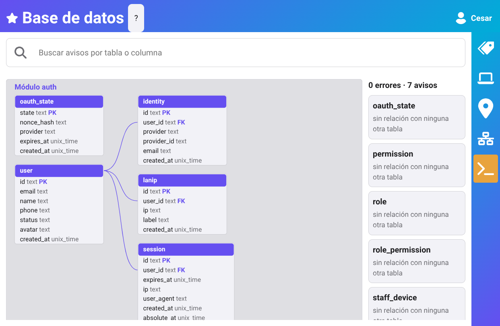

# erd


Database diagram (ERD) of webtyp models: tables, foreign keys and model errors, drawn as one SVG.

In an app, the «Developer tools → Database» screen (`webtyp/layout/schemaview`) shows it with its findings:



```go
// a module repo, from the models ormc scans
d := erd.ReadModule("alert_manager", models)
os.WriteFile("docs/diagrams/database.svg", []byte(d.Standalone()), 0o644) // repo.Write does this

// an app, one group per migration step: a reference to a table nobody creates is an error
d := erd.ReadApp(erd.Group{Name: "auth", Models: authModels}, erd.Group{Name: "rbac", Models: rbacModels})

// the app diagram from its migration steps
d, err := erd.ReadSteps(steps...)
if err := d.Check(); err != nil { t.Fatal(err) } // in a test: fail on schema errors
erd.Mount(r, erd.SchemaPath, d).Requires(erd.ResourceSchema, model.Read) // GET /_schema → Report
```

## In a repo

`go install webtyp.com/erd/cmd/erd@latest`, then `erd` at the repo root writes `docs/diagrams/database.svg`
(only when it changed). Never edit that file by hand; link it from `docs/ARCHITECTURE.md` as
``.

| Symbol | What |
|---|---|
| `ReadApp(groups ...Group) Diagram` | every table of an app, one band per module |
| `ReadSteps(steps ...ddl.Step) Diagram` | the app diagram from its migration steps |
| `ReadModule(name, models) Diagram` | one module alone; tables of other modules are dashed «external» boxes |
| `Diagram.SVG() string` | the drawing for a page that carries the app's stylesheet: classes and geometry only, coloured by `css.go` from the theme; same schema → same bytes; each table is `<g id="erd-table-<name>">` |
| `Diagram.Standalone() string` | the same drawing for a file opened outside any app: one `<style>` generated from the theme tokens and `RenderCSS`, never written by hand |
| `Diagram.Findings() []Finding` / `Check() error` | problems, errors first / an error only when one is an error |
| `Mount(r, path, d) router.Route` | read-only GET answering `Report{SVG, Findings}`; the caller declares access, never `Public()` |
| `ResourceSchema`, `SchemaPath`, `Report`, `Finding`, `Rule` | what a browser screen needs to fetch and list the findings |
| `ModuleLabel` | the English word before each band name («Module auth»); the server has no dictionary, so a screen replaces it with `lang.Translate(erd.ModuleLabel)` in `Report.SVG` |

## Findings

| Rule | Level | When |
|---|---|---|
| `missing_table` | error | a foreign key, or a select's `Options`, names a table no group creates (`ReadApp` only) |
| `type_mismatch` | error | the foreign key's storage type differs from the referenced primary key |
| `no_primary_key` | error | a table has no primary key |
| `cycle` | error | tables reference each other in a loop (a self-reference too: `ddl.TopologicalSort` refuses it) |
| `duplicate_table` | error | two groups create the same table |
| `isolated_table` | warning | a table with no foreign key or `Options` link in or out, among several tables |

Only what `model.Definition` declares is drawn: a foreign key (`Ref`) is a solid line, a select filled from
another table (`Options`) a dashed one, and a `*_id` column with neither is a plain column. Each row shows
the column's storage type (`text`, `int`, `bool`), or `unix_time`/`nano_time` for an instant; never the form
widget. Errors are painted in the drawing; warnings are listed only. Table heads and relations use the Primary role, a
soft link is dashed, an error is Danger; the drawing has no background of its own.

Design: [docs/ARCHITECTURE.md](docs/ARCHITECTURE.md).
